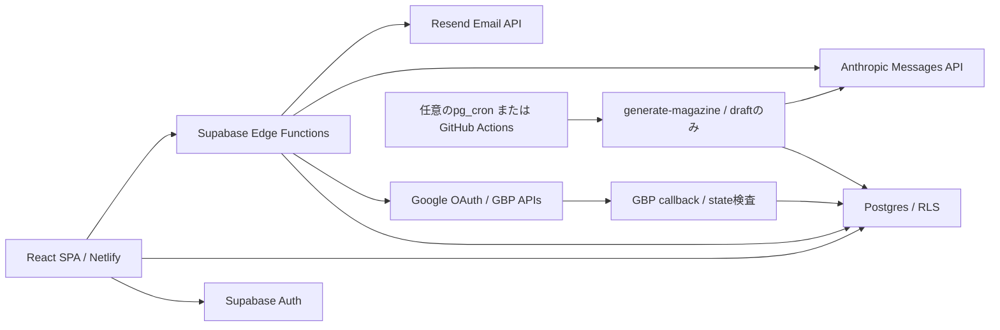

# 構成とコード案内

## 技術スタック

依存範囲は `package.json`、再現する実バージョンは `package-lock.json` が根拠です。今回lockで確認した値: React 18.3.1、TypeScript 5.8.3、Vite 5.4.21、Tailwind 3.4.19、Supabase JS 2.112.1、TanStack Query 5.101.4、React Router 6.30.4。Recharts・Lucide・Radix Dialogも使用。

Node推奨はREADMEと `netlify.toml` の22。今回PCは24.18.0 / npm11.16.0であり、22での今回再検証とは区別する。Edge FunctionsはDeno、Supabase JSを `https://esm.sh/@supabase/supabase-js@2` からimport。npm lockはこのリモート依存を固定しない。Denoの固定バージョン・lockは見当たらない。

## 入口と変更場所

| 変更する対象 | 最初に見るファイル・ディレクトリ |
| --- | --- |
| SPA起動・provider | `index.html` → `src/main.tsx` → `src/App.tsx` |
| ルート・ロール・施設選択 | `src/App.tsx`、`src/features/auth/`、`src/types/auth.types.ts` |
| 全体デザイン・ナビゲーション | `src/index.css`、`tailwind.config.js`、`src/components/layout/` |
| 管理者・担当者・施設管理 | `src/features/admin/use-admin.ts`、`src/features/console/use-console.ts`、`src/pages/admin/`、`src/pages/console/` |
| GBP通信・模擬通信 | `src/features/settings/gbp-api.ts`、`gbp-mode.ts`、`gbp-mock.ts`、`supabase/functions/_shared/gbp-oauth.ts` |
| 口コミ・返信 | `src/features/reviews/`、`src/pages/{Reviews,AIReply}.tsx` |
| 投稿・相談・テンプレート | `src/features/{posts,concierge,templates}/` と対応するpages |
| マガジン | `src/features/magazine/`、`src/pages/{Magazine,admin/AdminMagazine}.tsx` |
| チップス | `src/features/tips/`、`src/pages/admin/AdminTips.tsx` |
| DB変更 | `supabase/migrations/`。`src/types/database.types.ts` も同期。ただし手書き型はDDLの完全な代替ではない |
| ビルド・検証 | `package.json`、`vite.config.ts`、`tsconfig*.json`、`eslint.config.js`、`tests/` |
| 配置・スケジュール | `netlify.toml`、`supabase/config.toml`、`.github/workflows/monthly-magazine.yml` |

TanStack Queryで取得・mutation後のinvalidateを管理。`src/lib/supabase.ts` がフロントの単一クライアント。通常CRUDはanon key+ログインJWTでRLSを通す。特権操作は関数内でcallerを確認しservice-roleクライアントを使う設計（例外はBACKLOG）。

## Edge Function一覧

すべて `supabase/functions/<名前>/index.ts`。通常 `supabase.functions.invoke` からJSONで呼ぶ。エラーは多くが `{error}`/400で、HTTPステータス体系は統一されていない。

| 関数 | 主な入力 → 出力・副作用 |
| --- | --- |
| invite-consultant / delete-consultant | email/name/password、またはuser_id → Auth・profilesの作成/削除。admin |
| invite-user | facility/user/draft_note、任意facility_id → facility_id/user_id。複数テーブルとAuthに書込 |
| add-user-to-facility | facility_id/name/email/password → user_id。担当consultant/admin |
| manage-facility-user | facility_id/user_id/action/role_in_facility → 所属変更・削除、条件次第でAuth削除 |
| set-user-role | user_id/role → previous_role/role。admin |
| gbp-oauth-start | facility_id → Google認証url、state保存 |
| gbp-oauth-callback | URLのstate/code/error → 302でsettingsへ。token交換・候補/接続保存 |
| gbp-oauth-status | facility_id/pending_id → 接続状態・施設候補 |
| gbp-oauth-finalize | facility_id/pending_id/account_id/location_id → 接続保存 |
| gbp-disconnect | facility_id → 接続解除 |
| fetch-gbp-reviews | facility_id → synced。Google全ページ読取・reviews upsert |
| post-gbp-reply | review_id → posted。GoogleへPUT後DB更新 |
| post-gbp-post | post_id → posted。GoogleへPOST後DB更新 |
| calculate-meo-score | facility_id/search_views（任意）→ score等。月次upsert |
| generate-reply | review_id/style/facility_name/facility_context/review_text/rating → replies配列 |
| consult-meo | facility_id/question → answer |
| generate-magazine | 空JSON、またはcheck_configuration → magazine_id、またはready/missing/model |
| send-magazine | magazine_id/dry_run/test → sent/failed/failures/remaining、dry_runはrecipients/facilitiesも返す |

認可は関数ごとに実装され共通middlewareではない。新しいAPIを追加する際もUIのガードだけで保護されたと思わないこと。

## 定期・非同期処理

| 処理 | 実装・状態 |
| --- | --- |
| 月次draft生成 | cron式 `0 0 1 * *`。DB cronは拡張/ Vaultがある場合だけ登録。GitHub方式も存在し、二重稼働を避ける |
| GitHub手動実行 | `workflow_dispatch` は有効化Variableがfalseでも実行対象。Secretが必要。URLはworkflow内に本番が固定されている |
| OAuth callback | 公開HTTPエンドポイント。stateで検証。通常のWebhookではない |
| Authユーザー生成 | DB trigger `handle_new_user` がprofiles生成。認可上の注意はBACKLOG |
| スコア更新 | 画面の口コミ同期後に呼出。月次cronは見当たらない |
| 口コミ定期取得・予約投稿・自動返信・新着通知 | 実行worker/cronなし。設定/カラムの存在と区別 |
| Resend配送結果Webhook | 見当たらない。配信履歴はAPI受理とDB記録まで |

## LLM仕様と評価

| 機能 | モデル・プロンプト配置 | 入出力・失敗処理 |
| --- | --- | --- |
| マガジン | `generate-magazine/index.ts` のsystem/prompt。`ANTHROPIC_MODEL` 任意、既定 `claude-sonnet-4-6`、max_tokens2200 | ニュース/チップス→JSON summary/actions。文字数・型・3件検査、90秒timeout。失敗時400で保存しない。自動修復/再試行なし |
| 返信 | `generate-reply/index.ts` のprompt。固定 `claude-sonnet-4-20250514`、max_tokens1200 | クライアント提供口コミ・style→テキスト分割し最大3件。必ず3件の保証なし。API失敗400、timeout指定なし |
| 相談 | `consult-meo/index.ts` のsystem/messages。同じ固定モデル、max_tokens800 | DB文脈と質問→最初のtext。空/非2xxで400。エラー本文を最大300文字返す。timeout指定なし |
| オフライン返信 | `src/features/reviews/reply-generator.ts` | Supabase未設定時の定型文。実AIの品質評価には使えない |

モデルの現時点の提供・課金状態は未確認。`ANTHROPIC_MODEL` は返信/相談には適用されない。マガジンは資料内の指示に従わないsystem指示あり。他機能を含めプロンプト注入・誤情報・送信データ範囲の評価は未整備。

既存テストはマガジンの型・文字数・拒否・副作用をmockで検証し、文章品質・実モデル応答を評価しない。次の評価は独立環境の合成データで、低評価/高評価/空ニュース/矛盾ニュース/専門用語/長文/不正JSON/timeoutを対象に、正確性・文体・具体性・秘密値を返さないことを確認する（推奨、未実施）。
